# YHZ-Floor

**The complete, verifiable evidence bundle for a pre-registered ownership audit of AI-agent attack success.**

*Prepared for double-blind review (IEEE S&P 2027, Cycle 2). This repository is the anonymized evidence projection: no author identities, no experimental reruns during packaging, every retained record byte-preserving. The manuscript itself is delivered to reviewers through the venue's submission system.*


---

## What this is

A reported AI-agent attack-success number is a property of the **evaluation contract** that produced it — not an intrinsic property of the agent. The associated manuscript ("*Who Owns the Number? A Pre-Registered Audit of Five Owners Behind AI-Agent Attack Success*") measures the share of each owner through **hash-frozen, one-owner-at-a-time interventions** on matched cryptographic tasks: 33 registered cohorts, 3,562 retained sessions, plus a 60-session published-protocol audit — every design pre-specified, every number frozen before the first call.

## The registered 16-member family

Every information-contract cohort's paired contrast is **one-way**: no withheld seed ever beats its stated counterpart.



## The allowance owns part of the number

The external audit's headline finding: a published protocol's *declared 12,000-token allowance* censors 30 of 60 sessions into unshown reasoning — **six of ten task-level pairs are unmeasured, not failed**. Raising the allowance recovers the ceiling-censored slots under all five evaluator rules. A published rate is only as strong as the allowance it was measured under.



## Repository layout

```
YHZ-Floor/
├── README.md                        ← this file
├── assets/                          ← animated SVG figures (CSS/SMIL, no scripts)
│   ├── gen_animations.py            ← the generator
│   ├── owners_3d.svg                ← the five-owner decomposition (3D)
│   ├── discordance_family.svg       ← the Holm family, animated
│   └── allowance_censoring.svg      ← the M1 censoring story, animated
└── reviewer_bundle/                 ← the anonymized evidence projection (24,023 manifest files)
    ├── offline_checks.py            ← safe-default verification (no execution required)
    ├── MANIFEST.json                ← SHA-256 per file
    ├── COPY_LINEAGE.json            ← byte-preserving payload hashes
    ├── ANONYMITY_SCOPE.json         ← direct-identifier scan results
    ├── CLAIMS.json                  ← claim → evidence map
    ├── review.py                    ← optional reviewer re-execution entry points
    ├── h1r3/                        ← 852-session H1-R3 component + sandboxed replay
    ├── evidence/fixed_executor/     ← the historical 12/12 fixed-executor records
    ├── prior_validation/            ← prior portable-execution reports + BINDING.json
    └── source/sp2027/               ← analysis trees + the external-boundary wave records
        ├── research_execution/external_admission_amend1..5/   (HTB grid, NYU panel, frontier repanel)
        ├── research_execution/external_review_amend4_c1/      (C1 confirmatory review)
        └── research_execution/external_published_audit_20261110/  (the M1 published-protocol audit)
```

## Quick start — verify without executing anything

Python 3.10+ and the standard library suffice:

```sh
cd reviewer_bundle
python3 -B offline_checks.py verify
```

This checks **every manifest-listed payload** and reports missing, changed, or unlisted files. Expected: `integrity: PASS` over 24,023 files, 0 errors. The census (`python3 -B offline_checks.py census`) reads archived records only — it never runs attack programs, evaluates mutations, contacts a provider, or re-adjudicates cryptographic outcomes.

Optional reviewer re-execution (launches retained programs in a sandbox; **not** run during packaging):

```sh
python3 -B review.py h1r3 --output /tmp/acts-independent-h1r3
```

## How the numbers regenerate

Every registered statistic regenerates from the raw per-seed rows by **closed-form enumeration** (Python standard library — no statistical package) and is checked by the evidence gate shipped with the paper source. `SOURCE_MAP` pointers resolve each printed cell to its raw `results.jsonl` row. Nothing is pooled: each cohort's paired contrast stands on its own population, with Holm step-down over the registered family and Clopper–Pearson bounds per cohort.

## Provenance and anonymity

- **Byte-preserving packaging**: `COPY_LINEAGE.json` records source→destination SHA-256 for every copied payload; failed attempts remain separate and no trial was added or removed.
- **Anonymity**: `ANONYMITY_SCOPE.json` reports the direct-identifier scan (0 hits across author-name, email, affiliation, and handle needles). The submission renders with an empty author field; reference [1] is anonymized.
- **Frozen records carry infrastructure paths**: per the byte-preservation contract, some archived records retain the originating workstation's mount prefix (`/mnt/nvme5/ACTS-Attack/...`) — a filesystem location, not a user identity. Frozen records are never rewritten to conceal or decorate.
- **No rerun during packaging**: no attack program, mutation test, or provider call was executed while preparing this bundle; the component-level prior validation is bound to its exact archive (`prior_validation/BINDING.json`).

## The full campaign record

The reviewer bundle above is the *curated projection*. The **codes and the per-cohort experiment results** — runner and analyzer scripts, frozen preregistrations, per-session `results.jsonl` rows, censuses, verdict records, amendments, the decision ledger, and the canonical campaign inventory across all 33 registered cohorts / 3,562 retained sessions + the 60-session published-protocol audit — ship as a single release asset with a SHA-256 manifest:

**[Releases → v1.0.0-codes-results](../../releases/tag/v1.0.0-codes-results)** (107 MB):

```sh
sha256sum -c MANIFEST_CODES_RESULTS.sha256   # 117,330 files
tar xzf codes_results.tar.gz
```

Bulk raw material (per-turn provider responses, per-session prompt dumps, execution captures, ops event logs) is intentionally not part of this asset — the curated `reviewer_bundle/` in the repository root carries the retained-session evidence, and the raw originals remain available to the authors on request.

## Scope

None of this grades an agent. It accounts for who else owns the number — and it is **audit-only**: the external cohorts register where the instrument travels and where it stops, every boundary is named by its owner (transport, answer normalization, admission interface, benchmark domain, capability floor), and no benchmark-quality claim is made about any audited system. Negative results are the boundary of the claim, not caveats.

## The five preconditions (the YHZ floor)

1. **Strip** the task, mandatorily — every reported number carries its stripped twin on shared seeds.
2. **Declare** the acceptance rule, then test it — frozen before the first call, measured under every admissible coding.
3. **Never pool** distinct groups — every substitution disclosed with its boundary row.
4. **Publish** the raw outputs — claims attach to frozen per-seed rows and receipted censuses.
5. **Bind** the claim to its negatives — registered nulls stated as the claim's boundary.

A benchmark that skips these reproduces the failure modes this audit measured. The full checklist (condition → demand → what a compliant release shows) is Table 9 of the paper.

---

*Retained records are provided for review purposes; retained attack programs target local, self-contained fixtures with no reachable production target. During double-blind review the authors remain anonymous; correspondence flows through the venue.*
