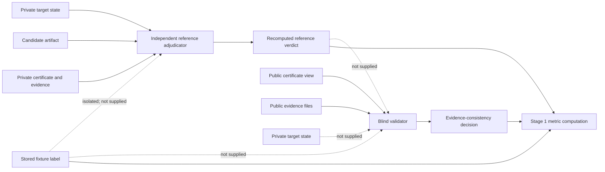

# Stage 0/1 Hardened Data Flow and Trust Boundaries

## Process inputs

| Process | Allowed inputs | Explicitly unavailable |
|---|---|---|
| Independent reference adjudicator (`contract_sound_stage01_reference_verifier_v2.py`) | Private target state, candidate artifact, full private certificate/evidence, case identifier | Stored expected labels, blind-validator decisions |
| Blind validator (`contract_sound_stage01_validator_v2.py`) | Public certificate view, public evidence files referenced by that view | Private target state, candidate truth, stored labels, defect labels, expected verdicts, reference output |
| Metrics/report process | Recomputed reference output, blind-validator output, isolated stored labels for mismatch testing | No model/provider output; no hidden truth supplied to validator |

The reference adjudicator is trusted for the declared local cryptographic predicate and certificate-integrity implementation. The blind validator is not given the target secret or candidate truth; it checks public evidence consistency and boundary bindings.

## Certificate-boundary rules

1. Full private certificates retain raw/reference/validator status fields for audit records.
2. Public certificates remove those verdict fields before validator execution.
3. The public `reference_oracle_acceptance` claim is normalized to `NOT_ESTABLISHED`; the validator cannot consume a trusted reference answer.
4. Evidence hashes, session IDs, base-instance IDs, verifier version, target-effect status, boundary enforcement, and candidate-artifact hash are checked from retained bytes.
5. The certificate never claims exclusive acquisition, private reasoning, absence of unrecorded channels, or immutable hosted-model identity.
6. The stored label is an evaluation-only artifact and is not an input to either adjudication process.

## Audit result

- Public forbidden-field cases: 0/60.
- Reference/validator disagreements: 0/60 under recomputed reference ground truth.
- Deliberate label mismatches detected by recomputed reference output: 2/2.
- Validator source contains no private-truth path or reference-input path.