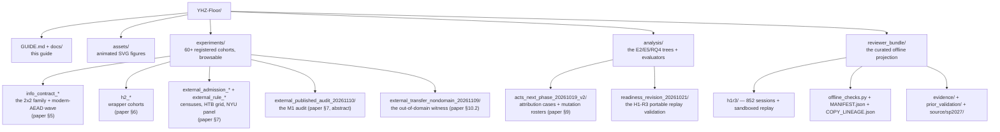

# Repository map

Every directory, what it carries, and where the paper cites it.

## Top-level files

| Path | Purpose |
|---|---|
| `README.md` | the overview page (animated figures, quick start) |
| `GUIDE.md` | this guide's front page |
| `assets/gen_animations.py` | regenerates the animated SVGs (CSS/SMIL only — no scripts run at render time) |
| `experiments/INDEX.md` | the per-cohort index: directory → paper section → registered statistic |
| `BUDGET_LEDGER.jsonl` | per-call cost estimates for the whole campaign (in `experiments/`) |

## The reviewer_bundle (offline projection)

| Path | Purpose |
|---|---|
| `offline_checks.py` | the no-execution verifier (`verify`) and census (`census`) |
| `MANIFEST.json` | SHA-256 per file (24,023 payloads) |
| `COPY_LINEAGE.json` | source→destination hashes (byte-preserving copies) |
| `ANONYMITY_SCOPE.json` | the direct-identifier scan results (0 hits) |
| `CLAIMS.json` | claim → evidence mapping |
| `review.py` | optional re-execution entry points (`h1r3`, `property`, `intoto`) |
| `h1r3/` | the complete 852-session component: retained programs, fixture state, prompts, outputs |
| `prior_validation/BINDING.json` | binds the older portable-execution report to the exact shipped archive |
| `source/sp2027/` | the wave trees the main text cites (Amend 1–5, C1 review, M1 audit) |

## What is deliberately absent

- The manuscript (compiled or source) — venue-only during double-blind review.
- Raw per-turn provider responses, per-session prompt dumps, execution captures, ops event logs — the per-slot rows carry every recorded outcome; raw bulk stays with the authors.
- Any author-identity material — scanned out (0 hits).

---

Next: <b><a href="../experiments/INDEX.md">Experiments index</a></b> &nbsp;·&nbsp; <a href="README.md">README</a> &nbsp;·&nbsp; <a href="https://0xlab-art.github.io/YHZ-Floor/">Rendered site</a>

