# Repository map

Every directory, what it carries, and where the records behind it live. `§` markers
point at the accompanying manuscript (under review, served through the venue only).

```mermaid
flowchart TD
    R["YHZ-Floor/"] --> G["GUIDE.md + docs/<br/>the guide and its pages"]
    R --> A["assets/<br/>animated SVG figures"]
    R --> T["tools/<br/>INDEX + figure generators"]
    R --> E["experiments/<br/>80 record directories + INDEX.md"]
    R --> AN["analysis/<br/>the campaign's working archive"]
    R --> RB["reviewer_bundle/<br/>the curated offline projection"]
    E --> E1["info_contract_* + diag_empty_* + blind_opportunity_*<br/>the 2×2 family, the AEAD wave, the power cohort (§4–5)"]
    E --> E2["h2_*<br/>the wrapper cohorts (§6)"]
    E --> E3["external_admission_* + external_rule_* + cvebench_census_*<br/>the external boundary: HTB grid, NYU panel, repanels (§7)"]
    E --> E4["external_published_audit_20261110/<br/>the M1 published-protocol audit (§7)"]
    E --> E5["external_transfer_nondomain_20261109/<br/>the out-of-domain witness (§10.2)"]
    E --> E6["exploratory_*<br/>the pre-registered-era probes (§8)"]
    AN --> A1["acts_next_phase_20261019*/<br/>attribution cases + mutation rosters (§9)"]
    AN --> A2["readiness_revision_20261021/<br/>the H1-R3 portable replay validation"]
    RB --> R1["h1r3/h1r3_complete_replay_v1/<br/>852 retained sessions + sandboxed execute_replay.py"]
    RB --> R2["offline_checks.py + MANIFEST.json + COPY_LINEAGE.json<br/>+ ANONYMITY_SCOPE.json"]
    RB --> R3["evidence/fixed_executor/ + source/sp2027/<br/>the executor records + the cited wave trees"]
```

## Top-level files

| Path | Purpose |
|---|---|
| `README.md` | the overview page: what this is, verify-first, the five owners, the counts reconciled |
| `GUIDE.md` | the reviewer guide's front page (lifecycle, setup, verification) |
| `EXPLANATION.md` | how to read the audit: estimand, censoring, the ledger |
| `CONTRIBUTING.md` | what contributions are welcome and what stays frozen |
| `SECURITY.md` | handling policy for the retained programs |
| `CITATION.cff` | the artifact's citation metadata |
| `experiments/INDEX.md` | the per-cohort index — generated by `tools/build_experiments_index.py` |
| `experiments/BUDGET_LEDGER.jsonl` | per-call cost estimates for the whole campaign (3,494 rows) |
| `assets/gen_animations.py` | regenerates the animated SVGs (CSS/SMIL only — nothing runs at render time) |
| `tools/build_experiments_index.py` | regenerates `experiments/INDEX.md` from the frozen tree |

## The reviewer_bundle (offline projection)

| Path | Purpose |
|---|---|
| `offline_checks.py` | the no-execution verifier (`verify`) and census (`census`) |
| `MANIFEST.json` | SHA-256 per payload (24,023 payloads) |
| `COPY_LINEAGE.json` | source→destination hashes (byte-preserving copies) |
| `ANONYMITY_SCOPE.json` | the direct-identifier scan results (0 hits) |
| `h1r3/h1r3_complete_replay_v1/` | the complete 852-session component: retained programs, fixture state, prompts, outputs, sandboxed `execute_replay.py` |
| `evidence/fixed_executor/` | the fixed-executor operation records (twelve historical recorded successes) |
| `source/sp2027/research_execution/` | the external-boundary wave trees the manuscript cites (Amend 1–5, the C1 review, the M1 audit) |
| `source/sp2027/analysis/` | the ablation/remediation trees (`experiment_b`, `heb1_*`) |

## What is deliberately absent

- The manuscript (compiled or source) — venue-only during double-blind review; the `§` markers are pointers, not links.
- The raw per-turn provider responses — per-slot rows and summaries carry every recorded outcome; the raw dumps remain with the authors, shareable on request.
- The authoring-time evidence gate — an authoring instrument of the private full candidate; the public reproducibility surface is [docs/VERIFYING.md](VERIFYING.md) Layers 1–2 plus the manifests.
