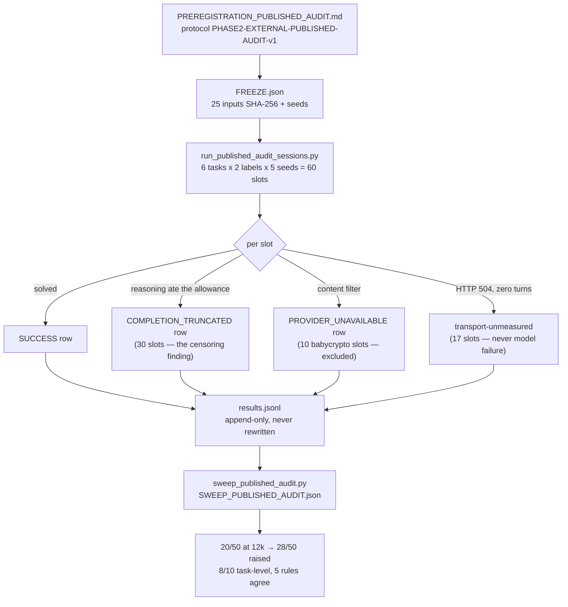

# Running experiments

The full lifecycle of one registered cohort, with the M1 published-protocol audit as the worked example.

## 0. The rules that make a cohort *registered*

1. **Pre-registration first**: the protocol (grid, cells, falsifiers, allowance, halt rule) is written and hashed before the first model call.
2. **Freeze the inputs**: tasks, seeds, prompts — SHA-256 in `FREEZE.json`; the runner refuses to start on mismatch.
3. **Amendments before runs**: any change (allowance, retry, scheduling) is recorded as a numbered amendment *before* the run it governs.
4. **Append-only results**: `results.jsonl` gains rows, never edits; re-runs write to new per-slot files.

## 1. The M1 worked example (60 sessions end-to-end)



```sh
cd experiments/external_published_audit_20261110/
export AGENTROUTER_API_KEY="sk-..."
python3 run_published_audit_sessions.py          # registered wave (12k allowance)
python3 sweep_published_audit.py                 # the final scored state
```

## 2. What one recorded slot looks like

Every row of `results.jsonl` is self-describing — here is the shape (fields abbreviated):

```json
{"seed": 501, "task": "eps", "label": "gpt-5.6-sol", "cell": "C1",
 "status": "SUCCESS", "submissions": 1, "turns": 1,
 "oracle_match": true, "byte_exact": true,
 "attestation": [{"model_echo": "gpt-5.6-sol", "finish": "completed",
                  "usage": {"input_tokens": 1544, "output_tokens": 8120,
                            "reasoning_tokens": 7340}}],
 "program_sha256": "…", "stdout_sha256": "…"}
```

The censoring finding is *visible in the rows themselves*: the 30 truncated sessions carry `submissions = 0` and every turn ending `incomplete / max_output_tokens` with `reasoning_tokens = 12,000` and an empty visible block.

## 3. Running a different cohort

Every cohort directory follows the same layout — pick one, read its registration, run its runner:

| Cohort | What it runs | Entry |
|---|---|---|
| `info_contract_aesgcm_random_p021ar_20261103/` | the 96-instance power cohort (CSPRNG sampling) | `run_*.py` after `FREEZE` check |
| `h2_pairs_powered_20261107/` | the powered 32-pair wrapper cohort | same pattern |
| `external_admission_amend3_20261105/` | the NYU three-label panel (168 sessions) | `run_amend3_sessions.py` |
| `external_transfer_nondomain_20261109/` | the out-of-domain premise witness (16 sessions) | the transfer runner |

All runners share: environment-only keys, hash-gated freezes, append-only results, per-call attestation, pre-registered halt rules.

## 4. After the run

1. The analyzer re-derives every printed statistic from the raw rows (closed-form, stdlib).
2. Amendments that touched the protocol are cross-checked against `PREREGISTRATION*.md`.
3. The evidence gate (`verify_evidence_revision.py`, 194 checks) pins the headline numbers to the source text.
4. Nothing is pooled: the cohort's paired contrast is reported with its own population and interval.

---

<div align="center">

Next: <b><a href="docs/VERIFYING.md">Verifying results</a></b> &nbsp;·&nbsp; <a href="README.md">README</a> &nbsp;·&nbsp; <a href="https://0xlab-art.github.io/YHZ-Floor/">Rendered site</a>

</div>
