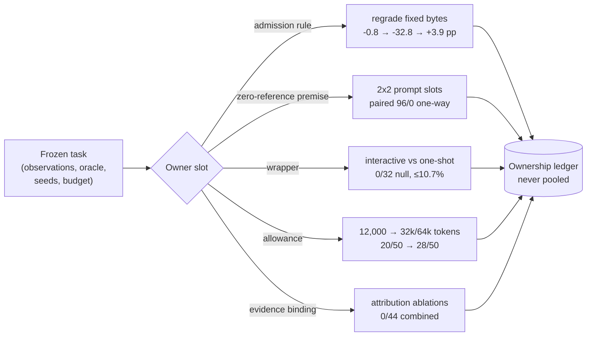
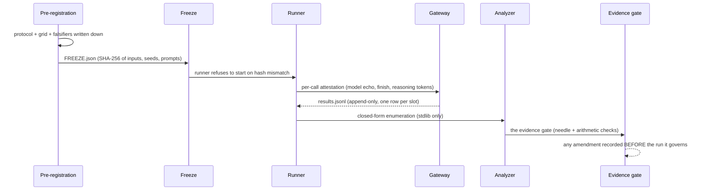

# 📗 The YHZ-Floor Guide

**Everything a reviewer needs: how the audit works, how to run it, how to verify it, and where every number in the paper comes from.**

| | |
|---|---|
| **New here?** | Start with [What this is](index.md), then this Guide top-to-bottom |
| **Want to check a number?** | [Verifying results](verifying.md) + [experiments/INDEX.md](experiments_index.md) |
| **Want to run an experiment?** | [Running experiments](running_experiments.md) |
| **Want to plug in your own API?** | [Setup & API](setup_and_api.md) |
| **Lost in the tree?** | [Repository map](repo_map.md) |

---

## 1. The audit model in one picture

Every reported attack-success number is produced by a **contract** with identifiable owners. The audit freezes everything, moves one owner at a time, and registers the contrast:



**The estimand**: each share is a *paired contrast on shared seeds* — an exact-binomial discordance with its interval, reported per cohort, never pooled. The registered family (16 cohorts) carries a Holm step-down at FWER 0.05 with per-cohort Clopper–Pearson bounds.

## 2. The experiment lifecycle

Every cohort in `experiments/` followed the same registered lifecycle — **before any model call**:



Concretely (the M1 published-protocol audit as the worked example — see [`experiments/external_published_audit_20261110/`](https://github.com/0xLAB-art/YHZ-Floor/blob/main/experiments/external_published_audit_20261110/)):

```sh
# 1. the freeze is live: inputs SHA-256 frozen, hash mismatch refuses to run
cat experiments/external_published_audit_20261110/FREEZE.json

# 2. the runner takes the API key from the environment (never from files)
export AGENTROUTER_API_KEY="sk-..."        # your own key — see SETUP_AND_API.md
python3 run_published_audit_sessions.py    # 6 tasks × 2 labels × 5 seeds = 60 slots

# 3. results land append-only; amendments are recorded before they run
wc -l results.jsonl                        # 60 registered rows, never rewritten
cat PREREGISTRATION_PUBLISHED_AUDIT.md     # Amendments 1–16, each pre-recorded
```

## 3. Plugging in an API

The runners speak an OpenAI-compatible gateway. Three rules the whole campaign followed:

1. **Keys live in the environment** — never in files, never in git. Every script reads `os.environ`.
2. **Every call is attested** — model echo, finish status, reasoning tokens recorded per call.
3. **Every allowance is declared** — the paper's headline finding is that an undeclared allowance censors results; don't reproduce that.

Full details, gateway quirks (the Responses-API transport, the `claude-cli` User-Agent requirement, the 420 s wall cap, content-filter behaviour), and a redacted config: **[Setup & API](setup_and_api.md)**.

## 4. Verifying the paper's numbers

Three independent layers, none requiring trust:

| Layer | Command | Checks |
|---|---|---|
| Bundle integrity | `python3 -B offline_checks.py verify` (in `reviewer_bundle/`) | every manifest payload's SHA-256 |
| Recorded-outcome census | `python3 -B offline_checks.py census` | the frozen verdict rows, no execution |
| Release manifest | `sha256sum -c MANIFEST_CODES_RESULTS.sha256` (release bundle) | 70,337 entries over the full codes+results tree |

Per-cohort regeneration is closed-form (standard library only): each cohort's `results.jsonl` rows → the printed statistic, by one script. **[Verifying results](verifying.md)** walks a worked example.

## 5. Where every number lives

**[experiments/INDEX.md](experiments_index.md)** maps all 80 record directories to their registered statistic and their manuscript section. Highlights:

| Cohort family | Paper section | Directory |
|---|---|---|
| The 2×2 family + modern-AEAD wave (16-member Holm family) | §5 | `experiments/info_contract_*` |
| The 96-instance power cohort + floor sensitivity | §5, Fig 4 | `experiments/info_contract_aesgcm_random_p021ar_20261103/`, `experiments/info_contract_aesgcm_c2_floor8000_p026_20261103/` |
| The wrapper cohorts (frozen/extension/powered) | §6 | `experiments/h2_*` |
| The external boundary (censuses, HTB grid, NYU panel, frontier repanel) | §7 | `experiments/external_admission_*`, `experiments/external_rule_*` |
| The M1 published-protocol audit | §7 | `experiments/external_published_audit_20261110/` |
| The out-of-domain transfer witness | §10.2 | `experiments/external_transfer_nondomain_20261109/` |
| Attribution ablations + mutation testing | §9 | `analysis/acts_next_phase_20261019_v2/` |

## 6. What is *not* here, and why

- **The manuscript**: during double-blind review the paper travels through the venue's submission system only.
- **Raw per-turn provider responses** (the largest bulk): the per-slot `results.jsonl` rows and per-slot summaries carry every recorded outcome; raw response dumps remain with the authors and can be shared on request.
- **Anything identity-carrying**: the bundle passed a direct-identifier scan (0 hits); frozen records retain a bare mount prefix (`/mnt/nvme5/...`) — a filesystem location, not an identity.

---

<div align="center" markdown="1">

Next: <b><a href="docs/SETUP_AND_API.md">Setup & API</a></b> &nbsp;·&nbsp; <a href="README.md">README</a> &nbsp;·&nbsp; <a href="https://0xlab-art.github.io/YHZ-Floor/">Rendered site</a>

</div>
