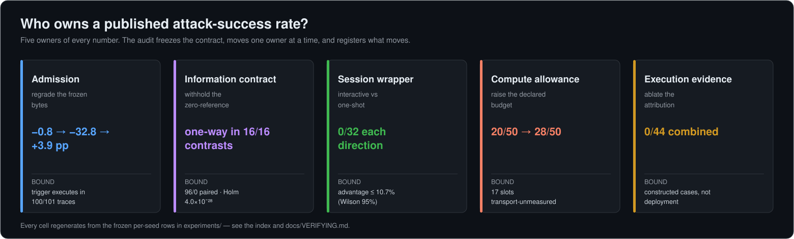
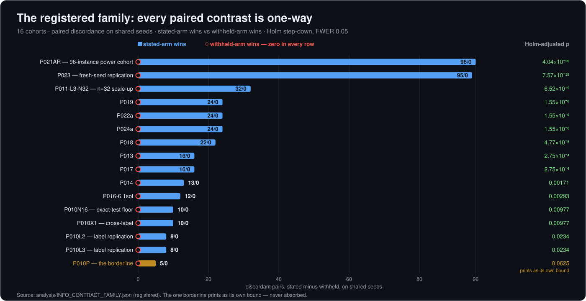
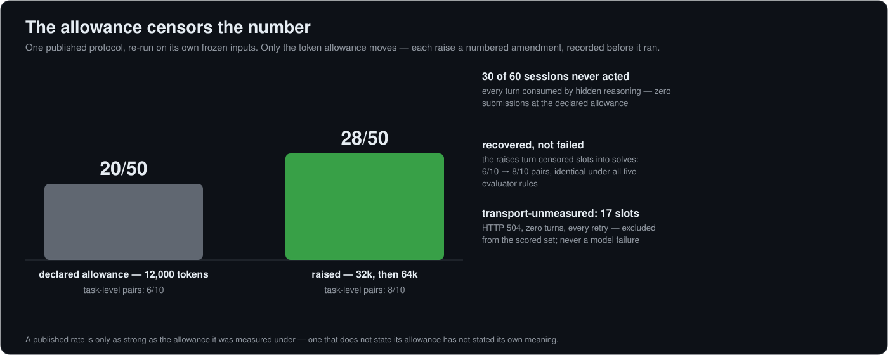

---
hide:
  - navigation
---

<div align="center" markdown="1">

# YHZ-Floor

**The complete, verifiable evidence bundle for a pre-registered, hash-frozen,
five-owner audit of AI-agent attack success.**

[](running_experiments.md)
[](#verify-before-you-read--10-seconds-no-trust-required)
[](https://github.com/0xLAB-art/YHZ-Floor/releases/tag/v1.0.0-codes-results)
[](https://github.com/0xLAB-art/YHZ-Floor/blob/main/LICENSE)
[](https://0xlab-art.github.io/YHZ-Floor/)

[Guide](guide.md) &nbsp;·&nbsp; [Explanation](guide.md) &nbsp;·&nbsp; [Experiments index](experiments_index.md) &nbsp;·&nbsp; [Rendered docs](https://0xlab-art.github.io/YHZ-Floor/) &nbsp;·&nbsp; [Contributing](https://github.com/0xLAB-art/YHZ-Floor/blob/main/CONTRIBUTING.md) &nbsp;·&nbsp; [Security](https://github.com/0xLAB-art/YHZ-Floor/blob/main/SECURITY.md) &nbsp;·&nbsp; [Cite](https://github.com/0xLAB-art/YHZ-Floor/blob/main/CITATION.cff)



</div>

## Why this exists

A published AI-agent attack-success rate is not a property of the model. It is the output of a **measurement contract** — the evaluator's acceptance rule, the task prompt's disclosures, the session wrapper, the token allowance, and the evidence binding a verdict to an execution.

This bundle freezes that contract, moves **one owner at a time** on matched cryptographic tasks, and serves every frozen row the numbers were measured on:

- **33 registered cohorts · 3,562 retained sessions** — every design pre-specified before the first model call
- a **separate 60-session published-protocol audit** of a public benchmark, run under its own declared rules
- one append-only `results.jsonl` per cohort — every printed statistic regenerates from those rows by closed-form enumeration, standard library only

## Verify before you read — 10 seconds, no trust required

```sh
cd reviewer_bundle
python3 -B offline_checks.py verify
```

```
integrity: PASS  ·  24,023 payloads  ·  0 errors
```

Every payload's SHA-256 is checked against `MANIFEST.json`. Nothing executes, nothing contacts a provider. That is the entry point: **every number on this page traces to rows you can open and recount yourself.** [docs/VERIFYING.md](verifying.md) re-derives the headline contrast in ten lines of standard-library Python.

## The five owners, and what moving each one did

> **Reading key.** *pp* = percentage points. *a/b* = paired discordance on shared seeds: *a* sessions succeeded with the owner moved, *b* with it held. *Holm* = family-wise correction across the 16 registered contrasts. *Wilson* = 95% confidence upper bound.

| Owner | Registered result | Bound that stays attached |
|---|---|---|
| **Admission** | regrade of fixed bytes: −0.8 → −32.8 → +3.9 pp | trigger executes in 100/101 retained traces |
| **Information contract** | paired one-way in 16/16 contrasts (96/0, Holm 4.0×10⁻²⁸) | RC4 4/4 · ECDSA 32/32 withheld · AES-GCM-SIV accepts nothing |
| **Session wrapper** | interactive vs one-shot: 0/32 each direction | advantage ≤ 10.7% (Wilson 95%) |
| **Compute allowance** | declared 12,000 vs raised: 20/50 → 28/50 | 17 slots transport-unmeasured |
| **Execution evidence** | attribution ablations: 0/44 combined (16/44, 28/44 alone) | constructed cases, not deployment rates |

## Finding 1 — the information contract dominates



Withhold the zero-reference premise and **no withheld seed ever beats its stated counterpart** — across every cohort, model label, and replication. The one borderline cohort (P010P, Holm 0.0625) prints as its own bound instead of being absorbed into the family. The negative controls bracket the claim from both sides: the honest-null cipher (RC4 4/4), the second fixture family (ECDSA 32/32 withheld), and the registered AES-GCM-SIV control that accepts nothing in any cell.

## Finding 2 — the allowance censors the number



Re-running a published benchmark protocol on its own frozen inputs, at that protocol's declared 12,000-token allowance: **30 of 60 sessions never act** — every turn spent in hidden reasoning, zero submissions. Six of ten task-level pairs are *unmeasured, not failed*. Raising the allowance (32k, then 64k — each change a numbered amendment recorded before it ran) recovers them: 28/50, 8/10 pairs, identical under all five evaluator rules.

**A published rate is only as strong as the allowance it was measured under.**

## Explore

| You want to… | Go to |
|---|---|
| check a specific number | [experiments/INDEX.md](experiments_index.md) → the cohort's `results.jsonl` |
| understand the audit model | [EXPLANATION.md](guide.md) — the estimand, the censoring, reading the ledger |
| run a cohort yourself | [docs/RUNNING_EXPERIMENTS.md](running_experiments.md) — the M1 audit end-to-end |
| plug in your own API key | [docs/SETUP_AND_API.md](setup_and_api.md) — environment-only keys, gateway behaviour |
| re-derive the printed statistics | [docs/VERIFYING.md](verifying.md) — three verification layers |
| execute the retained programs | `reviewer_bundle/h1r3/h1r3_complete_replay_v1/execute_replay.py` — sandboxed; see [SECURITY.md](https://github.com/0xLAB-art/YHZ-Floor/blob/main/SECURITY.md) |
| read it as a rendered site | [0xlab-art.github.io/YHZ-Floor](https://0xlab-art.github.io/YHZ-Floor/) |
| cite this artifact | [CITATION.cff](https://github.com/0xLAB-art/YHZ-Floor/blob/main/CITATION.cff) |

## Repository layout

```
YHZ-Floor/
├── experiments/         ← 80 record directories + INDEX.md (registrations, per-session
│                           results.jsonl, analyses, sweeps, the cost ledger)
├── analysis/            ← the campaign's working trees: E2/E5/RQ4, evaluators,
│                           the H1-R3 replay validation (see analysis/README.md)
├── reviewer_bundle/     ← the curated offline projection (24,023 manifest payloads)
│                           offline_checks.py · MANIFEST.json · COPY_LINEAGE.json ·
│                           ANONYMITY_SCOPE.json · h1r3/ (852 sessions + sandboxed
│                           replay) · source/sp2027/ (the cited wave trees)
├── GUIDE.md + docs/     ← the guide: setup, running, verifying (mermaid + examples)
├── EXPLANATION.md       ← how to read the audit
├── tools/               ← regenerate INDEX.md, the figures, and the docs site
└── assets/              ← the SVG figures (banner_owners, fig_family, fig_censoring)
```

## The three counts, reconciled

- **80 record directories** serve here — registered cohorts, diagnostics, controls, and superseded first passes, every one listed in [experiments/INDEX.md](experiments_index.md).
- **33 registered cohorts · 3,562 retained sessions** — the pre-specified session inventory; populations are never pooled.
- **60 sessions** — the M1 published-protocol audit, a separate population by design.
- **24,023 payloads** — the curated `reviewer_bundle` projection checked by `offline_checks.py`; the [release bundle](https://github.com/0xLAB-art/YHZ-Floor/releases/tag/v1.0.0-codes-results) ships its own 70,337-entry SHA-256 manifest over the full codes+results tree.

## Provenance & scope

- **Byte-preserving packaging** — `COPY_LINEAGE.json` records source→destination SHA-256 for every payload; no trial was added or removed.
- **No rerun during packaging** — no attack program, mutation test, or provider call was executed while preparing the bundle; the component-level validation is bound to its exact archive.
- **Identity hygiene** — a campaign-wide direct-identifier scan returns 0 hits (`reviewer_bundle/ANONYMITY_SCOPE.json`); frozen records keep a bare mount prefix, which is a filesystem location, not an identity.
- **The manuscript is not here** — during double-blind review it travels through the venue's submission system only; the `§` markers in the index point at it.
- **Not in the bundle** — raw per-turn provider responses remain with the authors and are shareable on request; the per-slot rows and summaries carry every recorded outcome.

---

<details markdown="1">
<summary>Retained-programs notice</summary>

Retained records are provided for review purposes. Retained attack programs target local, self-contained fixtures — containers with reserved secrets and a same-host reference oracle, no reachable production target. Execute them only inside the provided sandboxed replay (`reviewer_bundle/h1r3/h1r3_complete_replay_v1/`) or your own equivalent isolation. See [SECURITY.md](https://github.com/0xLAB-art/YHZ-Floor/blob/main/SECURITY.md).

</details>
